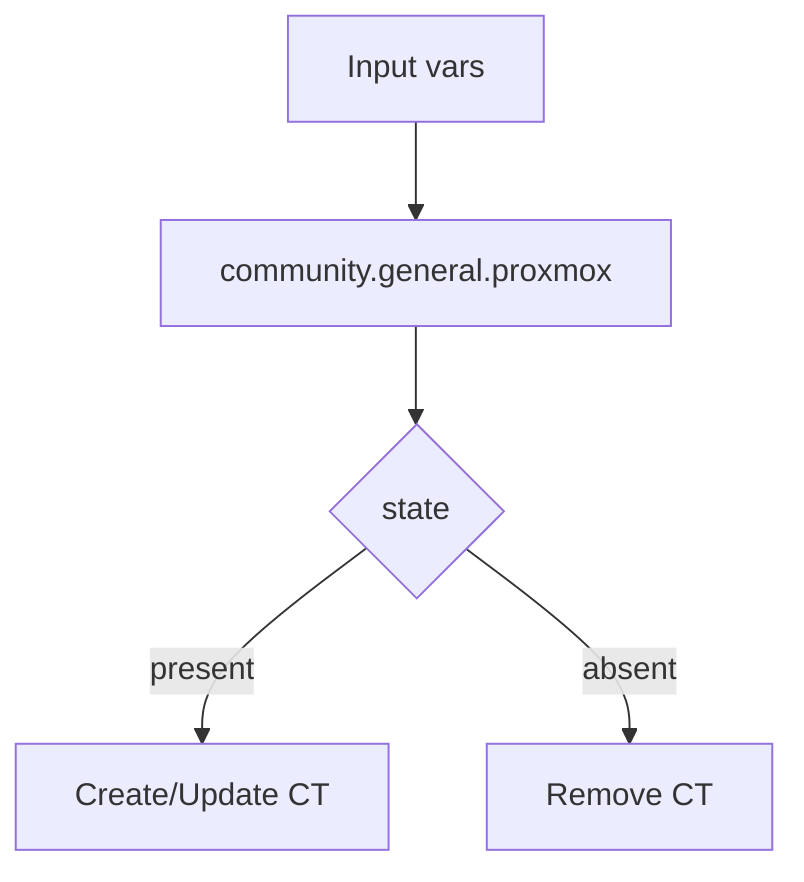

# Role: ct_instance

## Purpose
Declaratively manage Proxmox CT lifecycle (create/update/delete).

## Usage
```yaml
- hosts: pve_hosts
  gather_facts: false
  roles:
    - role: ktooi.pve_inference.ct_instance
```

## Flow


## Variables

| Variable | Description | Default | Allowed values |
|---|---|---|---|
| `ct_instance_api_host` | Proxmox API host/IP | `{{ inventory_hostname }}` | Valid hostname/IP |
| `ct_instance_api_user` | Proxmox API user | `root@pam` | Valid PVE API user |
| `ct_instance_api_token_id` | API token name (preferred) or legacy `<user>!<token_name>` | `""` | `ci-token` (preferred), or `<user>!<token_name>` |
| `ct_instance_api_token_secret` | API token secret | `""` | Token secret string |
| `ct_instance_validate_certs` | Validate HTTPS cert for Proxmox API | `false` | `true` / `false` |
| `ct_instance_password` | Initial CT root password (optional) | `""` | Non-empty string (prefer vault) |
| `ct_instance_pubkey` | Initial CT root public key (optional) | `""` | SSH public key line |
| `ct_instance_node` | Target node name | `pve` | Existing node name |
| `ct_instance_storage` | Storage ID for CT root disk (`disk` parameter) | `local-lvm` | Existing storage ID |
| `ct_instance_ostemplate` | CT template path | `local:vztmpl/debian-12-standard_12.0-1_amd64.tar.zst` | Existing template path |
| `ct_instance_vmid` | CT VMID | `100` | Positive integer |
| `ct_instance_hostname` | CT hostname | `ct-infer` | Valid hostname |
| `ct_instance_cores` | vCPU cores | `8` | Integer `>=1` |
| `ct_instance_memory` | Memory (MiB) | `32768` | Integer `>=512` |
| `ct_instance_swap` | Swap (MiB) | `8192` | Integer `>=0` |
| `ct_instance_rootfs_size` | Root disk size (GiB logical; passed as `disk: <storage>:<size>`) | `128` | Integer `>=8` |
| `ct_instance_netif` | CT network map | `{'net0':'name=eth0,bridge=vmbr0,ip=dhcp'}` | Proxmox netif map |
| `ct_instance_onboot` | Start on host boot | `true` | `true` / `false` |
| `ct_instance_unprivileged` | Unprivileged CT mode | `false` | `true` / `false` |
| `ct_instance_features` | Proxmox CT features (`map` or `list`) (applied only for unprivileged CT, or when `ct_instance_api_user` is `root@pam`) | `{'nesting': 0}` | Feature map (`{nesting: 1}`) or list (`['nesting=1']`) |
| `ct_instance_mounts` | Mount points map | `{}` | Proxmox mounts map |
| `ct_instance_timeout` | Proxmox task wait timeout (seconds) | `600` | Integer `>=30` |
| `ct_instance_treat_timeout_as_existing_ct` | On create-time timeout, continue when CT exists (`pct status <vmid>` succeeds) | `true` | `true` / `false` |
| `ct_instance_enable_nvidia_passthrough` | Manage NVIDIA device passthrough entries in `/etc/pve/lxc/<vmid>.conf` | `false` | `true` / `false` |
| `ct_instance_restart_on_nvidia_passthrough_change` | Restart CT when passthrough block changes | `true` | `true` / `false` |
| `ct_instance_nvidia_gpus` | Host GPU device nodes exposed to this CT | `null` | `all`, non-empty list of unique non-negative integers, or `null` |
| `ct_instance_nvidia_passthrough_block` | Complete raw override; non-empty values bypass automatic device discovery and feature flags | `""` (automatic generation) | Multiline LXC config text |
| `ct_instance_nvidia_bind_driver_libraries` | Include file-level binds for `libcuda.so.1`/`libnvidia-ml.so.1` in managed NVIDIA passthrough block | `true` | `true` / `false` |
| `ct_instance_nvidia_mount_host_cuda_toolkit` | Bind-mount host CUDA toolkit directory into CT in managed NVIDIA passthrough block | `false` | `true` / `false` |
| `ct_instance_host_cuda_toolkit_path` | Host toolkit path used when `ct_instance_nvidia_mount_host_cuda_toolkit=true` | `/usr/local/cuda` | Absolute path |
| `ct_instance_nvidia_mount_host_cuda_toolkit_into_nvidia_prefix` | Also bind-mount host CUDA toolkit into CT `/usr/local/nvidia` path to satisfy runtimes that resolve nvcc/toolkit under that prefix | `true` | `true` / `false` |
| `ct_instance_state` | Desired CT state | `present` | `present` / `absent` / module-supported states |


## Note on vLLM and privileged mode
`ct_instance_unprivileged: false` is **not** a hard requirement for vLLM.
In this collection, vLLM readiness is validated by GPU visibility checks inside CT (for example `/dev/nvidia*`, `libcuda.so.1`, and `torch.cuda`), not by privileged mode itself.


> For vLLM on CUDA inside CT, enabling `ct_instance_enable_nvidia_passthrough` is typically required.


> If CT already exists, the role treats the existing-CT error as an acceptable rerun and continues with post-create tasks to keep reruns idempotent.


> When create waits hit timeout but CT is already present, the role can continue (`ct_instance_treat_timeout_as_existing_ct: true`).
> Also, passthrough restart logic tolerates `pct stop` returning `CT <vmid> not running`.

> Automatic passthrough inspects actual character-device major/minor numbers, including UVM and capability devices. Rerun this role after driver updates, device changes, or a reboot that changes those numbers. If the managed block changes, the existing CT restart option applies.


> Host-CUDA recommendation: for CT runtimes that require `${CUDA_HOME}/bin/nvcc`, set `ct_instance_nvidia_mount_host_cuda_toolkit=true` and `ct_instance_host_cuda_toolkit_path` to a real host toolkit path. In this mode, consider `ct_instance_nvidia_bind_driver_libraries=false` to avoid file-level bind mounts that can conflict with CT-side apt package management.

## Select or share NVIDIA GPUs

To expose every available GPU to a CT:

```yaml
ct_instance_enable_nvidia_passthrough: true
ct_instance_nvidia_gpus: all
```

Set the same selection for multiple CTs to share those GPUs. For example, STT and
image-generation CTs can both use `all`. For a subset, use `[0, 2]`. Numbers refer
to host device names (`/dev/nvidia0`, `/dev/nvidia2`), not container-local CUDA
ordinals. They do not set `CUDA_VISIBLE_DEVICES` or model parallelism.

The default `null` preserves the legacy GPU 0/1 selection, including only those
nodes that exist as character devices. It does not automatically expose additional
GPUs. Explicit lists must contain valid, available device numbers; missing GPUs,
empty/duplicate lists, negative numbers, booleans, and numeric strings fail before
CT lifecycle changes. `all` requires at least one available GPU.

The role also requires `/dev/nvidiactl` and `/dev/nvidia-uvm`, includes existing
modeset/UVM-tools/capability devices, and generates exact cgroup major/minor rules
without GPU-major wildcards. Prepare the host driver and device nodes first with
`host_nvidia_gpu`. The read-only discovery module supports check mode.

Automatic generation retains the driver-library and host-toolkit flags above.
For a complete custom configuration, set `ct_instance_nvidia_passthrough_block`
to a non-empty string. That block is used directly: GPU selection, discovery,
and automatic library/toolkit entries are skipped. Restore an empty string to
return to automatic generation.

Only the marked `ANSIBLE MANAGED NVIDIA PASSTHROUGH` block is replaced. Existing
unmanaged GPU mounts or wildcard permissions can still expose other devices.
Disabling passthrough skips management; it does not remove an existing block.

Sharing does not reserve GPUs, impose CT VRAM quotas, or schedule inference.
Keep per-model memory budgets and parallelism in the runtime configuration.
See [the shared STT/image example](../../examples/shared-nvidia/README.md) for
separate CT definitions and runtime host variables.
