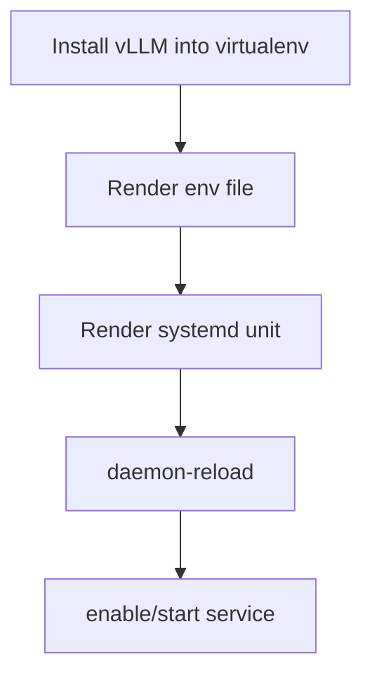

# Role: ct_runtime_vllm

## Purpose
Install/configure vLLM inside CT and manage it with systemd.

Supported CT distributions: Debian 12/13, Ubuntu 22.04/24.04 LTS, and RHEL/AlmaLinux/Rocky/Oracle Linux 9/10.

This role can consume shared values from `ct_runtime_launcher_common`, while runtime-specific variables (for example `ct_runtime_vllm_model`) continue to work as before.

## Usage
```yaml
- hosts: ct_targets
  become: true
  roles:
    - role: ktooi.pve_inference.ct_runtime_common
    - role: ktooi.pve_inference.ct_runtime_vllm
```

### Tuning example
```yaml
ct_runtime_vllm_model: "Qwen/Qwen3.5-27B"
ct_runtime_vllm_tensor_parallel_size: 4
ct_runtime_vllm_pipeline_parallel_size: 1
ct_runtime_vllm_gpu_memory_utilization: 0.88
ct_runtime_vllm_dtype: "auto"
ct_runtime_vllm_kv_cache_dtype: "auto"
ct_runtime_vllm_max_model_len: 262144
ct_runtime_vllm_max_num_seqs: 128
ct_runtime_vllm_max_num_batched_tokens: 8192
ct_runtime_vllm_enable_mtp: true
ct_runtime_vllm_mtp_num_speculative_tokens: 1
ct_runtime_vllm_tool_call_parser: "qwen3_coder"
ct_runtime_vllm_reasoning_parser: "qwen3"
ct_runtime_vllm_enable_auto_tool_choice: true
ct_runtime_vllm_served_model_name: "qwen3.5"
ct_runtime_vllm_nccl_p2p_disable: 0
ct_runtime_vllm_nccl_ib_disable: 0
ct_runtime_vllm_nccl_p2p_level: 5
ct_runtime_vllm_nccl_debug: "INFO"
ct_runtime_vllm_nccl_ignore_disabled_p2p: 1
ct_runtime_vllm_ld_library_path: "/usr/local/nvidia/lib64:/usr/local/nvidia/lib:/usr/lib/x86_64-linux-gnu"
```

## Flow


## Variables

| Variable | Description | Default | Allowed values |
|---|---|---|---|
| `ct_runtime_vllm_user` | Service user | `infer` | Existing Linux username |
| `ct_runtime_vllm_group` | Service group | `infer` | Existing Linux group |
| `ct_runtime_vllm_venv` | venv path containing `vllm` | `/opt/inference/venv` | Absolute path |
| `ct_runtime_vllm_workdir` | systemd WorkingDirectory | `/opt/inference` | Absolute path |
| `ct_runtime_vllm_env_file` | Environment file path | `/etc/default/vllm` | Absolute path |
| `ct_runtime_vllm_resolver_options` | Optional service `RES_OPTIONS` for the glibc DNS resolver | `""` (omit) | Single-line, space-separated resolver options |
| `ct_runtime_vllm_base_path` | Literal base PATH after the resolved nvcc directory | `/usr/local/sbin:/usr/local/bin:/usr/sbin:/usr/bin:/sbin:/bin` | Colon-separated executable directories |
| `ct_runtime_vllm_service_name` | systemd service unit name | `vllm.service` | Valid unit name |
| `ct_runtime_vllm_systemd_log_to_files` | Mirror service stdout/stderr to files and journald | `true` | `true` / `false` |
| `ct_runtime_vllm_systemd_dump_runtime_env` | Dump sorted runtime environment variables to stderr at service start (for debugging) | `false` | `true` / `false` |
| `ct_runtime_vllm_stdout_log` | vLLM stdout log file path (when file logging enabled) | `/var/log/inference/vllm.stdout.log` | Absolute path |
| `ct_runtime_vllm_stderr_log` | vLLM stderr log file path (when file logging enabled) | `/var/log/inference/vllm.stderr.log` | Absolute path |
| `ct_runtime_vllm_systemd_restart` | systemd restart policy for vLLM service | `on-failure` | `no`, `on-failure`, `always`, ... |
| `ct_runtime_vllm_systemd_restart_sec` | Delay before restart attempts | `3` | Integer/seconds string |
| `ct_runtime_vllm_install_cuda_userspace` | Install CUDA userspace libs inside CT | `true` | `true` / `false` |
| `ct_runtime_vllm_use_host_cuda_stack` | Prefer host-provided CUDA stack in CT and disable CT-internal CUDA package/repo/nvcc auto-remediation paths | `false` | `true` / `false` |
| `ct_runtime_vllm_host_cuda_toolkit_mount_hint` | Hint path shown in strict nvcc failure when host-CUDA mode is enabled and toolkit is not mounted | `/usr/local/cuda` | Absolute path |
| `ct_runtime_vllm_cuda_packages` | CUDA userspace package list | distro-dependent | Package list |
| `ct_runtime_vllm_fail_on_cuda_package_install` | Fail when CUDA package install fails | `false` | `true` / `false` |
| `ct_runtime_vllm_require_libcuda` | Require `libcuda.so.1` preflight check (when `ct_runtime_vllm_device=cuda`) | `true` | `true` / `false` |
| `ct_runtime_vllm_require_nvidia_smi` | Require `nvidia-smi -L` preflight check (when `ct_runtime_vllm_device=cuda`) | `true` | `true` / `false` |
| `ct_runtime_vllm_fail_on_nvidia_smi_probe` | Fail when `nvidia-smi` preflight fails | `false` | `true` / `false` |
| `ct_runtime_vllm_require_torch_cuda_available` | Require torch CUDA preflight probe (when `ct_runtime_vllm_device=cuda`) | `true` | `true` / `false` |
| `ct_runtime_vllm_torch_cuda_probe_mode` | Torch CUDA readiness mode | `strict` | `strict` (requires `is_available`+`device_count`), `count` (requires only `device_count`) |
| `ct_runtime_vllm_libcuda_candidate_paths` | Extra file paths checked for `libcuda.so.1` in CT | see defaults | List of absolute paths |
| `ct_runtime_vllm_require_nvidia_device_nodes` | Require `/dev/nvidia*` in CT (when `ct_runtime_vllm_device=cuda`) | `true` | `true` / `false` |
| `ct_runtime_vllm_device` | vLLM device selection | `cuda` | `cuda`, `cpu`, runtime-supported values |
| `ct_runtime_vllm_force_device_arg` | Force `--device` CLI arg even for CUDA (off by default for CLI compatibility) | `false` | `true` / `false` |
| `ct_runtime_vllm_logging_level` | vLLM logging verbosity | `INFO` | `DEBUG`, `INFO`, `WARNING`, ... |
| `ct_runtime_vllm_bind_host` | API bind host | `0.0.0.0` | IP/host string |
| `ct_runtime_vllm_port` | API port | `8000` | Integer `1..65535` |
| `ct_runtime_vllm_model` | Base/merged model identifier or local directory | `mistralai/Mistral-7B-Instruct-v0.3` | Model ID or absolute model directory |
| `ct_model_artifacts` | Files downloaded and checksum-verified before configuring the runtime | `[]` | See [artifact role](../ct_model_artifacts/README.md) |
| `ct_runtime_vllm_lora_adapters` | Local PEFT adapters: name/path and optional Omni scale | `[]` | See [LoRA deployment](../../docs/lora-deployment.md) |
| `ct_runtime_vllm_max_lora_rank` | Core LoRA maximum rank; emitted only with configured core adapters | `16` | Positive integer supported by vLLM |
| `ct_runtime_vllm_served_model_name` | Candidate served model name value | `""` | Empty, string, or list (first non-empty string is used) |
| `ct_runtime_vllm_pass_served_model_name` | Pass `--served-model-name` to vLLM CLI | `false` | `true` / `false` |
| `ct_runtime_vllm_tensor_parallel_size` | Tensor parallel size | `1` | Integer `>=1` |
| `ct_runtime_vllm_pipeline_parallel_size` | Pipeline parallel size | `1` | Integer `>=1` |
| `ct_runtime_vllm_gpu_memory_utilization` | GPU memory utilization ratio | `0.9` | Float `0.1..1.0` |
| `ct_runtime_vllm_dtype` | Weights/compute dtype | `auto` | `auto`, `float16`, `bfloat16`, etc. |
| `ct_runtime_vllm_kv_cache_dtype` | KV cache dtype | `auto` | `auto`, `fp8`, etc. |
| `ct_runtime_vllm_max_model_len` | Max model context length | `8192` | Integer `>=1` |
| `ct_runtime_vllm_max_num_seqs` | Max concurrent sequences | `32` | Integer `>=1` |
| `ct_runtime_vllm_max_num_batched_tokens` | Max batched tokens | `4096` | Integer `>=1` |
| `ct_runtime_vllm_enable_mtp` | Enable core vLLM speculative decoding with the configured method | `false` | `true` / `false` |
| `ct_runtime_vllm_speculative_method` | Speculative method name passed in `--speculative_config` JSON | `mtp` | Runtime-supported method string (e.g. `qwen3_next_mtp`) |
| `ct_runtime_vllm_mtp_num_speculative_tokens` | MTP speculative depth (`--speculative_config` JSON) | `1` | Integer `>=1` |
| `ct_runtime_vllm_tool_call_parser` | Tool call parser backend | `""` | Empty or parser name |
| `ct_runtime_vllm_reasoning_parser` | Reasoning parser backend | `""` | Empty or parser name |
| `ct_runtime_vllm_language_model_only` | Force language-only path for multimodal-capable checkpoints (`--language-model-only`) | `false` | `true` / `false` |
| `ct_runtime_vllm_enable_auto_tool_choice` | Enable vLLM `--enable-auto-tool-choice` | `false` | `true` / `false` |
| `ct_runtime_vllm_nccl_p2p_disable` | NCCL P2P disable flag | `0` | `0` / `1` |
| `ct_runtime_vllm_nccl_ib_disable` | NCCL IB disable flag | `0` | `0` / `1` |
| `ct_runtime_vllm_nccl_p2p_level` | NCCL P2P level | `5` | Integer |
| `ct_runtime_vllm_nccl_debug` | NCCL debug level | `INFO` | `TRACE`, `INFO`, `WARN`, ... |
| `ct_runtime_vllm_nccl_ignore_disabled_p2p` | Ignore disabled P2P warning | `1` | `0` / `1` |
| `ct_runtime_vllm_omp_num_threads` | OMP thread count | `""` | Empty or integer string |
| `ct_runtime_vllm_ld_library_path` | Library search path | `/usr/local/nvidia/lib64:/usr/local/nvidia/lib:/usr/lib/x86_64-linux-gnu` | PATH-like string |
| `ct_runtime_vllm_cuda_home` | Explicit CUDA toolkit root exported as `CUDA_HOME` for runtime processes | `""` (auto-derive) | Empty or absolute path (e.g. `/usr/local/cuda`) |
| `ct_runtime_vllm_require_nvcc` | Fail preflight when `CUDA_HOME`/`nvcc` cannot be resolved in CT | `true` | `true` / `false` |
| `ct_runtime_vllm_auto_install_nvcc_toolkit` | Auto-install toolkit packages when `nvcc` is missing in CT | `true` | `true` / `false` |
| `ct_runtime_vllm_repository_source` | CT-side CUDA package source selector for nvcc remediation | `debian` | `debian`, `nvidia` |
| `ct_runtime_vllm_nvcc_toolkit_packages` | Toolkit package list used for nvcc auto-remediation | distro-dependent | Package list |
| `ct_runtime_vllm_manage_nvidia_cuda_repo` | Configure NVIDIA official CUDA apt repository in CT before nvcc remediation (opt-in) | `false` | `true` / `false` |
| `ct_runtime_vllm_nvidia_cuda_repo_url` | NVIDIA CUDA repository URL for CT | `https://developer.download.nvidia.com/compute/cuda/repos/debian13/x86_64/` | Valid apt repo URL |
| `ct_runtime_vllm_nvidia_cuda_repo_keyring_deb_url` | NVIDIA CUDA keyring package URL for CT | `https://developer.download.nvidia.com/compute/cuda/repos/debian13/x86_64/cuda-keyring_1.1-1_all.deb` | Valid URL |
| `ct_runtime_vllm_nvidia_cuda_repo_keyring_path` | Installed keyring path used for signed-by in CT | `/usr/share/keyrings/cuda-archive-keyring.gpg` | Absolute path |
| `ct_runtime_vllm_nvidia_cuda_repo_list_filename` | apt sources list filename for CT NVIDIA repo | `nvidia-cuda` | filename without extension |
| `ct_runtime_vllm_auto_install_nvcc_pip_fallback` | Try pip-based nvcc fallback when apt candidates are unavailable | `true` | `true` / `false` |
| `ct_runtime_vllm_nvcc_pip_package` | pip package used for nvcc fallback | `nvidia-cuda-nvcc-cu12` | pip package spec |
| `ct_runtime_vllm_hf_cache_dir` | Legacy combined HF home/cache location; sets `HF_HOME` and `HUGGINGFACE_HUB_CACHE` | `""` | Empty or absolute path; mutually exclusive with the new hub-only setting |
| `ct_runtime_vllm_hf_hub_cache_dir` | Repository cache only; sets `HF_HUB_CACHE` and `HUGGINGFACE_HUB_CACHE`, leaving `HF_HOME` local | `""` | Empty or absolute path without whitespace/traversal |
| `ct_runtime_vllm_hf_token` | Hugging Face Hub token exported as `HF_TOKEN` | `""` | Empty or token string (prefer Ansible Vault) |
| `ct_runtime_vllm_extra_args` | Extra CLI args | `""` | String |
| `ct_runtime_vllm_version` | Pin version (optional) | `""` | Empty or semantic version string |
| `ct_runtime_vllm_torch_package` | Optional pinned torch package reinstalled **after** vLLM install (for CUDA/driver alignment) | `""` | Empty or pip requirement string (e.g. `torch==2.6.0`) |
| `ct_runtime_vllm_torch_extra_index_url` | Optional extra index URL for `ct_runtime_vllm_torch_package` | `""` | Empty or URL (e.g. `https://download.pytorch.org/whl/cu124`) |
| `ct_runtime_vllm_torch_backend` | Informational compatibility hint only (not passed to `vllm serve`) | `""` | Empty or backend string (e.g. `cu129`) |


> CUDA preflight note: by default this role validates `/dev/nvidia*`, `libcuda.so.1`, `nvidia-smi -L`, and torch CUDA visibility. `nvidia-smi` failures are warnings by default (`ct_runtime_vllm_fail_on_nvidia_smi_probe: false`) while torch preflight remains enforced. Torch `strict` mode requires both `torch.cuda.is_available()==True` and `device_count > 0`. Use `ct_runtime_vllm_torch_cuda_probe_mode: count` only if you intentionally want a relaxed check. When `ct_runtime_vllm_torch_backend` or `ct_runtime_vllm_version` is set, preflight is automatically relaxed from `strict` to `count` to avoid false negatives caused by installer/backend mismatches before vLLM runtime initialization.
>
> NVCC/CUDA_HOME note: some vLLM/Triton combinations require `nvcc`/`CUDA_HOME` at runtime. This role derives `CUDA_HOME` from `ct_runtime_vllm_cuda_home`, `/usr/local/cuda`, `command -v nvcc`, `/usr/local/cuda-*/bin/nvcc`, pip fallback package resolution (including `venv/bin/nvcc` probe), when toolkit binaries are unavailable, and writes it into `vllm` environment. The role intentionally does not treat `/usr/local/nvidia` alone as CUDA_HOME unless `nvcc` is actually resolvable, because some kernels (e.g. FlashInfer paths) invoke `${CUDA_HOME}/bin/nvcc` directly. If `ct_runtime_vllm_cuda_home` is set but `<cuda_home>/bin/nvcc` is missing, the explicit value is ignored and auto-detection is used to avoid `/usr/local/nvidia/bin/nvcc: not found` runtime failures. When resolved, it also prepends the derived nvcc `bin` path to `PATH` in the vLLM env file.
> systemd environment files do not expand `${PATH}`. When nvcc is resolved, the role writes a complete literal `PATH` and `INFER_VLLM_PATH`, then restores that path after login-profile processing so both system commands and nvcc remain available. Customize the literal base directories with `ct_runtime_vllm_base_path`.
> By default `ct_runtime_vllm_require_nvcc=true`, so the role fails preflight instead of starting a broken service when nvcc/CUDA_HOME cannot be resolved.
> When `ct_runtime_vllm_repository_source: nvidia` is used, nvcc auto-remediation dynamically selects the newest available `cuda-toolkit-<major>-<minor>` package from apt metadata (instead of Debian's `nvidia-cuda-toolkit` name) before retrying nvcc detection.
> Host-CUDA mode note: when `ct_runtime_vllm_use_host_cuda_stack=true`, this role disables CT-internal CUDA userspace install, NVIDIA repo management, and nvcc auto-remediation paths even if those flags are set, and emits a warning with overridden values. If strict nvcc check fails in this mode, the error explicitly reminds you that `/usr/local/nvidia` is not a toolkit and requests a host-mounted toolkit path (for example `/usr/local/cuda`).

> APT consistency note: before CT-side CUDA userspace remediation on apt-based systems, this role checks `dpkg --audit`. If package state is already broken/incomplete, strict nvcc mode fails early with explicit guidance (for example `apt --fix-broken install`) instead of proceeding into opaque dependency failures.
> NVCC fallback caveat: pip fallback packages may be unavailable for some Python/CUDA combinations; when that occurs this role surfaces pip install stderr in the strict nvcc assertion message to speed remediation.
> In some environments the pip package may be installed but still not provide an `nvcc` binary payload. In that case the strict assertion includes `pip show -f` output; configure `ct_runtime_vllm_cuda_home` to a real toolkit path (for example `/usr/local/cuda-12.x`) or install toolkit packages from a CUDA-enabled apt repository.

> Driver/torch alignment note: to align CT torch CUDA with host driver, set `ct_runtime_vllm_torch_package` (and optionally `ct_runtime_vllm_torch_extra_index_url`). This role installs the selected vLLM, audio, Omni, and additional packages in one transaction, then force-reinstalls the specified torch package in the same venv. Choose a torch wheel compatible with the selected vLLM/Omni releases and host driver.

> `--torch-backend` note: in current vLLM releases, `--torch-backend` is an install-time (`uv pip`) option, not a stable `vllm serve` runtime flag across versions. This role does not pass `--torch-backend` to `vllm serve`.

> Logging note: when `ct_runtime_vllm_systemd_log_to_files=true` (default), this role now mirrors stdout/stderr to both log files (`/var/log/inference/vllm.stdout.log`, `/var/log/inference/vllm.stderr.log`) and journald, so `journalctl -u vllm.service` remains usable.
> Debug note: set `ct_runtime_vllm_systemd_dump_runtime_env=true` temporarily to print process environment at startup (`[vllm-env] begin/end`) into stderr logs/journald for CUDA_HOME/PATH troubleshooting; disable after investigation.

> CLI compatibility note: older vLLM versions may reject `--device cuda`. This role omits `--device` for CUDA by default and only passes it for non-CUDA devices (or when `ct_runtime_vllm_force_device_arg=true`).

> Environment naming note: runtime command variables are exported with `INFER_VLLM_*` names (not `VLLM_*`) to avoid `Unknown vLLM environment variable` warnings emitted by newer vLLM versions.

> HF Hub authentication note: to avoid `Warning: You are sending unauthenticated requests to the HF Hub...`, set `ct_runtime_vllm_hf_token` (preferably via Ansible Vault) so the role writes `HF_TOKEN` into the runtime environment file.

For shared model storage, prefer `ct_runtime_vllm_hf_hub_cache_dir` and leave
legacy `ct_runtime_vllm_hf_cache_dir` empty. The legacy setting is preserved for
existing callers but also moves `HF_HOME`, which includes credential storage.
Both settings cannot be used together. Enable `ct_model_storage_enabled` for
mount/type/permission validation and a startup guard; the runtime supplies its
service user and unit automatically. This applies to core and Omni. See
[shared model storage](../../docs/shared-model-storage.md).

> DNS note: when service-user probes show that `single-request-reopen` resolves A/AAAA lookup failures, set `ct_runtime_vllm_resolver_options: single-request-reopen`. The role exports `RES_OPTIONS` in the service environment file; the empty default omits it. This applies to the service's glibc resolver without changing CT nameservers or host networking. See [Hugging Face network troubleshooting](../../docs/troubleshooting-hf-network.md). The runtime playbook enables/starts vLLM, so finish storage recovery and capacity checks before rerunning it.

> Restart-loop note: default policy is `on-failure` (not `always`) so normal exits do not loop forever. If you still see restarts, inspect `/var/log/inference/vllm.stderr.log` and kernel OOM logs (`dmesg -T | grep -i -E 'killed process|out of memory'`).

> Served-model-name note: if shared launcher vars accidentally provide a list (for example `['qwen3.5', None]`), this role normalizes it to the first non-empty string. Passing `--served-model-name` is disabled by default (`ct_runtime_vllm_pass_served_model_name=false`) because some vLLM versions reject/validate this path strictly.

> Extra-args note: `ct_runtime_vllm_extra_args` is appended only when non-empty, preventing empty trailing CLI arguments and accidental line-concatenation artifacts in systemd `ExecStart` parsing.

## NVIDIA userspace readiness

The role resolves `nvidia-smi` on the CT command search path and probes it before
installing model Python packages. Failure diagnostics include the resolved path,
command error, stdout, and stderr, distinguishing a missing executable from NVML
or dynamic-linker errors. Strict mode rejects failed or empty probes before
model package installation.

When `ct_runtime_vllm_use_host_cuda_stack=true`, automatic CT-side NVIDIA/CUDA
package installation is disabled. A host toolkit mount and two driver-library
binds alone do not provide `nvidia-smi`. To use the host executable, set
`ct_instance_nvidia_bind_nvidia_smi: true` in the **PVE-side CT creation variables**
and rerun CT creation to apply the mount. The matching driver libraries and CT
shared-library dependencies must be available. See
[the CT role's host userspace options](../ct_instance/README.md#host-nvidia-userspace-bindings).

For CT-managed NVIDIA userspace, provide packages compatible with the host driver
after disabling conflicting file binds. Keep host kernel-module installation in
the host role.

## Deploying audio, image, and video models

For checksum-pinned model/adapter downloads and declarative LoRA configuration,
see [LoRA deployment](../../docs/lora-deployment.md). Core registers named
adapters; Omni uses request-time selection. An empty adapter list preserves the
existing launch arguments.

The official main-branch documentation was reviewed on 2026-11-03. Supported models
and APIs depend on the installed release. New features documented on main may be
unavailable in earlier stable releases.

| Capability | Backend | Example model / API |
|---|---|---|
| STT (transcription) | core | `openai/whisper-large-v3-turbo` / `/v1/audio/transcriptions` |
| Transcription with speaker diarization | core | `OpenMOSS-Team/MOSS-Transcribe-Diarize` / `diarized_json` on the same API |
| Image generation | omni (requires vLLM-Omni) | `Qwen/Qwen-Image` / `/v1/images/generations` |
| Video generation | omni (requires vLLM-Omni) | `Wan-AI/Wan2.2-T2V-A14B-Diffusers` / `/v1/videos` |

Whisper itself does not perform speaker diarization. `diarized_json` requires a
model that supports it. Diarization here produces transcription segments with
speaker labels and timestamps; it does not separate speakers into audio files.
Core vLLM's image/video input support differs from Omni's image/video generation.

### Common deployment steps

Prepare a CT with GPU passthrough and an inventory containing `ct_targets`. Add one
of the configurations below to `group_vars/ct_targets.yml`. Each service deploys one
model. To serve multiple capabilities concurrently, use separate CTs for the models
and plan GPU memory allocation.

```bash
ansible-playbook -i inventory.ini playbooks/runtime_vllm.yml
```

### STT

```yaml
ct_runtime_vllm_backend: core
ct_runtime_vllm_audio: true
ct_runtime_vllm_model: openai/whisper-large-v3-turbo
ct_runtime_vllm_max_model_len: 448
ct_runtime_vllm_max_num_batched_tokens: 4096
```

```bash
curl --fail http://CT_HOST:8000/v1/audio/transcriptions \
  -F model=openai/whisper-large-v3-turbo -F file=@speech.wav \
  -F language=ja -F response_format=json
```

### STT with speaker diarization

```yaml
ct_runtime_vllm_backend: core
ct_runtime_vllm_audio: true
ct_runtime_vllm_model: OpenMOSS-Team/MOSS-Transcribe-Diarize
ct_runtime_vllm_max_model_len: 8192
```

```bash
curl --fail http://CT_HOST:8000/v1/audio/transcriptions \
  -F model=OpenMOSS-Team/MOSS-Transcribe-Diarize -F file=@meeting.wav \
  -F response_format=diarized_json
```

The response's `segments` contain `speaker`, `start`, `end`, and `text`.
Check that MOSS appears in the selected release's supported model list. Older
vLLM releases require an upgrade.

### Image generation / video generation

```yaml
ct_runtime_vllm_backend: omni
ct_runtime_vllm_model: Qwen/Qwen-Image
# For video generation, replace the model above with:
# ct_runtime_vllm_model: Wan-AI/Wan2.2-T2V-A14B-Diffusers
ct_runtime_vllm_version: '0.32.0'
ct_runtime_vllm_omni_version: '0.32.0'
```

The 0.32.0 pairing follows the official Omni installation instructions reviewed
above. The upstream test environment uses Python 3.12, PyTorch 2.13, and CUDA 13.0.
A compatible NVIDIA driver and sufficient VRAM are required. CT OS support alone
does not guarantee wheel, Python, or CUDA compatibility. Use a fresh dedicated venv
and configure `ct_runtime_common` and this role to use the same venv path.
For Omni, the role does not automatically add LLM memory, KV cache, tool parser,
parallelism, language-model-only, or MTP arguments. Core retains its configured
language-model and MTP options in both file-logging modes. Set model-specific
parallelism and offloading options
through `ct_runtime_vllm_extra_args`, following the official model instructions.

```bash
curl --fail http://CT_HOST:8000/v1/images/generations \
  -H 'Content-Type: application/json' \
  -d '{"model":"Qwen/Qwen-Image","prompt":"A cat in a garden","size":"1024x1024"}'

curl --fail http://CT_HOST:8000/v1/videos \
  -F model=Wan-AI/Wan2.2-T2V-A14B-Diffusers \
  -F prompt='A cat walking through a garden'
```

The video API is asynchronous. Use the returned `id` to check completion with
`GET /v1/videos/{id}`, then download the result from `GET /v1/videos/{id}/content`.
Resolution, frame count, and other generation settings depend on the model.

### Upgrades and version management

| Variable | Default | Purpose |
|---|---|---|
| `ct_runtime_vllm_backend` | `core` | `core` or `omni` |
| `ct_runtime_vllm_audio` | `false` | Add audio dependencies through `vllm[audio]` |
| `ct_runtime_vllm_pip_state` | `present` | Set to `latest` to upgrade when rerunning the role |
| `ct_runtime_vllm_version` | Empty string | Pin vLLM; leave empty for no version pin |
| `ct_runtime_vllm_omni_version` | Empty string | Pin Omni; leave empty for no version pin |
| `ct_runtime_vllm_additional_packages` | `[]` | Additional model-specific pip requirements |

To follow the latest releases, clear the version pins and set
`ct_runtime_vllm_pip_state: latest`. vLLM and Omni dependencies are resolved in a
single pip invocation, and package changes notify a service restart. Omni's
compatibility constraints may select a different vLLM version from the latest
standalone release. In production, pin both versions according to the upstream
compatibility guidance and test actual audio or generation requests in a dedicated
CT before upgrading. Compatibility with arbitrary future releases is not guaranteed.
Pass additional CLI options through `ct_runtime_vllm_extra_args` using only values
trusted by the administrator. Provide network access for model downloads and, when
needed, a Vault-managed `ct_runtime_vllm_hf_token`. Expose the API on an internal
network or behind an authenticated proxy.

### Official references and validation scope

- [vLLM supported models](https://github.com/vllm-project/vllm/blob/9226d6e59cd12ddd9a80b7d5ed37b16e186d29c6/docs/models/supported_models.md)
- [STT / diarized_json](https://github.com/vllm-project/vllm/blob/9226d6e59cd12ddd9a80b7d5ed37b16e186d29c6/docs/serving/online_serving/speech_to_text.md)
- [Omni installation](https://github.com/vllm-project/vllm-omni/blob/c4b31f0c56ab1f4e33f286c5d1c72268b8cf35a5/docs/getting_started/installation/gpu/cuda.inc.md)
- [Omni video API](https://github.com/vllm-project/vllm-omni/blob/c4b31f0c56ab1f4e33f286c5d1c72268b8cf35a5/docs/user_guide/examples/online_serving/text_to_video.md)

Local validation covers configuration, templates, and Ansible syntax. GPU model
loading, recognition accuracy, and image/video generation have not been tested
on deployment hardware.
