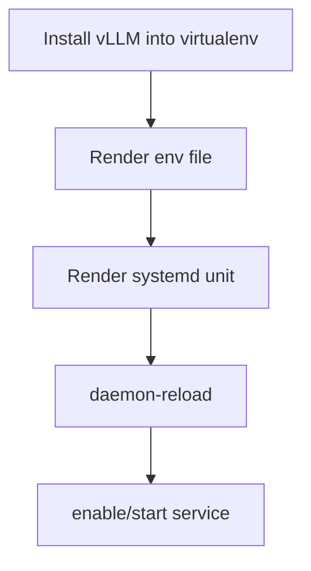

# Role: ct_runtime_vllm

## Purpose
Install/configure vLLM inside CT and manage it with systemd.

Supported CT distributions: Debian 12/13, Ubuntu 22.04/24.04 LTS, and RHEL/AlmaLinux/Rocky/Oracle Linux 9/10.

This role can consume shared values from `ct_runtime_launcher_common`, while runtime-specific variables (for example `ct_runtime_vllm_model`) continue to work as before.

## Usage
```yaml
- hosts: ct_targets
  become: true
  roles:
    - role: ktooi.pve_inference.ct_runtime_common
    - role: ktooi.pve_inference.ct_runtime_vllm
```

### Tuning example
```yaml
ct_runtime_vllm_model: "Qwen/Qwen3.5-27B"
ct_runtime_vllm_tensor_parallel_size: 4
ct_runtime_vllm_pipeline_parallel_size: 1
ct_runtime_vllm_gpu_memory_utilization: 0.88
ct_runtime_vllm_dtype: "auto"
ct_runtime_vllm_kv_cache_dtype: "auto"
ct_runtime_vllm_max_model_len: 262144
ct_runtime_vllm_max_num_seqs: 128
ct_runtime_vllm_max_num_batched_tokens: 8192
ct_runtime_vllm_enable_mtp: true
ct_runtime_vllm_mtp_num_speculative_tokens: 1
ct_runtime_vllm_tool_call_parser: "qwen3_coder"
ct_runtime_vllm_reasoning_parser: "qwen3"
ct_runtime_vllm_enable_auto_tool_choice: true
ct_runtime_vllm_served_model_name: "qwen3.5"
ct_runtime_vllm_nccl_p2p_disable: 0
ct_runtime_vllm_nccl_ib_disable: 0
ct_runtime_vllm_nccl_p2p_level: 5
ct_runtime_vllm_nccl_debug: "INFO"
ct_runtime_vllm_nccl_ignore_disabled_p2p: 1
ct_runtime_vllm_ld_library_path: "/usr/local/nvidia/lib64:/usr/local/nvidia/lib:/usr/lib/x86_64-linux-gnu"
```

## Flow


## Variables

| Variable | Description | Default | Allowed values |
|---|---|---|---|
| `ct_runtime_vllm_user` | Service user | `infer` | Existing Linux username |
| `ct_runtime_vllm_group` | Service group | `infer` | Existing Linux group |
| `ct_runtime_vllm_venv` | venv path containing `vllm` | `/opt/inference/venv` | Absolute path |
| `ct_runtime_vllm_workdir` | systemd WorkingDirectory | `/opt/inference` | Absolute path |
| `ct_runtime_vllm_env_file` | Environment file path | `/etc/default/vllm` | Absolute path |
| `ct_runtime_vllm_service_name` | systemd service unit name | `vllm.service` | Valid unit name |
| `ct_runtime_vllm_systemd_log_to_files` | Write service stdout/stderr to files via systemd `append:` | `true` | `true` / `false` |
| `ct_runtime_vllm_stdout_log` | vLLM stdout log file path (when file logging enabled) | `/var/log/inference/vllm.stdout.log` | Absolute path |
| `ct_runtime_vllm_stderr_log` | vLLM stderr log file path (when file logging enabled) | `/var/log/inference/vllm.stderr.log` | Absolute path |
| `ct_runtime_vllm_systemd_restart` | systemd restart policy for vLLM service | `on-failure` | `no`, `on-failure`, `always`, ... |
| `ct_runtime_vllm_systemd_restart_sec` | Delay before restart attempts | `3` | Integer/seconds string |
| `ct_runtime_vllm_install_cuda_userspace` | Install CUDA userspace libs inside CT | `true` | `true` / `false` |
| `ct_runtime_vllm_use_host_cuda_stack` | Prefer host-provided CUDA stack in CT and disable CT-internal CUDA package/repo/nvcc auto-remediation paths | `false` | `true` / `false` |
| `ct_runtime_vllm_cuda_packages` | CUDA userspace package list | distro-dependent | Package list |
| `ct_runtime_vllm_fail_on_cuda_package_install` | Fail when CUDA package install fails | `false` | `true` / `false` |
| `ct_runtime_vllm_require_libcuda` | Require `libcuda.so.1` preflight check (when `ct_runtime_vllm_device=cuda`) | `true` | `true` / `false` |
| `ct_runtime_vllm_require_nvidia_smi` | Require `nvidia-smi -L` preflight check (when `ct_runtime_vllm_device=cuda`) | `true` | `true` / `false` |
| `ct_runtime_vllm_fail_on_nvidia_smi_probe` | Fail when `nvidia-smi` preflight fails | `false` | `true` / `false` |
| `ct_runtime_vllm_require_torch_cuda_available` | Require torch CUDA preflight probe (when `ct_runtime_vllm_device=cuda`) | `true` | `true` / `false` |
| `ct_runtime_vllm_torch_cuda_probe_mode` | Torch CUDA readiness mode | `strict` | `strict` (requires `is_available`+`device_count`), `count` (requires only `device_count`) |
| `ct_runtime_vllm_libcuda_candidate_paths` | Extra file paths checked for `libcuda.so.1` in CT | see defaults | List of absolute paths |
| `ct_runtime_vllm_require_nvidia_device_nodes` | Require `/dev/nvidia*` in CT (when `ct_runtime_vllm_device=cuda`) | `true` | `true` / `false` |
| `ct_runtime_vllm_device` | vLLM device selection | `cuda` | `cuda`, `cpu`, runtime-supported values |
| `ct_runtime_vllm_force_device_arg` | Force `--device` CLI arg even for CUDA (off by default for CLI compatibility) | `false` | `true` / `false` |
| `ct_runtime_vllm_logging_level` | vLLM logging verbosity | `INFO` | `DEBUG`, `INFO`, `WARNING`, ... |
| `ct_runtime_vllm_bind_host` | API bind host | `0.0.0.0` | IP/host string |
| `ct_runtime_vllm_port` | API port | `8000` | Integer `1..65535` |
| `ct_runtime_vllm_model` | Model identifier | `mistralai/Mistral-7B-Instruct-v0.3` | Valid model identifier |
| `ct_runtime_vllm_served_model_name` | Candidate served model name value | `""` | Empty, string, or list (first non-empty string is used) |
| `ct_runtime_vllm_pass_served_model_name` | Pass `--served-model-name` to vLLM CLI | `false` | `true` / `false` |
| `ct_runtime_vllm_tensor_parallel_size` | Tensor parallel size | `1` | Integer `>=1` |
| `ct_runtime_vllm_pipeline_parallel_size` | Pipeline parallel size | `1` | Integer `>=1` |
| `ct_runtime_vllm_gpu_memory_utilization` | GPU memory utilization ratio | `0.9` | Float `0.1..1.0` |
| `ct_runtime_vllm_dtype` | Weights/compute dtype | `auto` | `auto`, `float16`, `bfloat16`, etc. |
| `ct_runtime_vllm_kv_cache_dtype` | KV cache dtype | `auto` | `auto`, `fp8`, etc. |
| `ct_runtime_vllm_max_model_len` | Max model context length | `8192` | Integer `>=1` |
| `ct_runtime_vllm_max_num_seqs` | Max concurrent sequences | `32` | Integer `>=1` |
| `ct_runtime_vllm_max_num_batched_tokens` | Max batched tokens | `4096` | Integer `>=1` |
| `ct_runtime_vllm_enable_mtp` | Enable vLLM MTP (`method=mtp`) | `false` | `true` / `false` |
| `ct_runtime_vllm_speculative_method` | Speculative method name passed in `--speculative_config` JSON | `mtp` | Runtime-supported method string (e.g. `qwen3_next_mtp`) |
| `ct_runtime_vllm_mtp_num_speculative_tokens` | MTP speculative depth (`--speculative_config` JSON) | `1` | Integer `>=1` |
| `ct_runtime_vllm_tool_call_parser` | Tool call parser backend | `""` | Empty or parser name |
| `ct_runtime_vllm_reasoning_parser` | Reasoning parser backend | `""` | Empty or parser name |
| `ct_runtime_vllm_language_model_only` | Force language-only path for multimodal-capable checkpoints (`--language-model-only`) | `false` | `true` / `false` |
| `ct_runtime_vllm_enable_auto_tool_choice` | Enable vLLM `--enable-auto-tool-choice` | `false` | `true` / `false` |
| `ct_runtime_vllm_nccl_p2p_disable` | NCCL P2P disable flag | `0` | `0` / `1` |
| `ct_runtime_vllm_nccl_ib_disable` | NCCL IB disable flag | `0` | `0` / `1` |
| `ct_runtime_vllm_nccl_p2p_level` | NCCL P2P level | `5` | Integer |
| `ct_runtime_vllm_nccl_debug` | NCCL debug level | `INFO` | `TRACE`, `INFO`, `WARN`, ... |
| `ct_runtime_vllm_nccl_ignore_disabled_p2p` | Ignore disabled P2P warning | `1` | `0` / `1` |
| `ct_runtime_vllm_omp_num_threads` | OMP thread count | `""` | Empty or integer string |
| `ct_runtime_vllm_ld_library_path` | Library search path | `/usr/local/nvidia/lib64:/usr/local/nvidia/lib:/usr/lib/x86_64-linux-gnu` | PATH-like string |
| `ct_runtime_vllm_cuda_home` | Explicit CUDA toolkit root exported as `CUDA_HOME` for runtime processes | `""` (auto-derive) | Empty or absolute path (e.g. `/usr/local/cuda`) |
| `ct_runtime_vllm_require_nvcc` | Fail preflight when `CUDA_HOME`/`nvcc` cannot be resolved in CT | `true` | `true` / `false` |
| `ct_runtime_vllm_auto_install_nvcc_toolkit` | Auto-install toolkit packages when `nvcc` is missing in CT | `true` | `true` / `false` |
| `ct_runtime_vllm_repository_source` | CT-side CUDA package source selector for nvcc remediation | `debian` | `debian`, `nvidia` |
| `ct_runtime_vllm_nvcc_toolkit_packages` | Toolkit package list used for nvcc auto-remediation | distro-dependent | Package list |
| `ct_runtime_vllm_manage_nvidia_cuda_repo` | Configure NVIDIA official CUDA apt repository in CT before nvcc remediation (opt-in) | `false` | `true` / `false` |
| `ct_runtime_vllm_nvidia_cuda_repo_url` | NVIDIA CUDA repository URL for CT | `https://developer.download.nvidia.com/compute/cuda/repos/debian13/x86_64/` | Valid apt repo URL |
| `ct_runtime_vllm_nvidia_cuda_repo_keyring_deb_url` | NVIDIA CUDA keyring package URL for CT | `https://developer.download.nvidia.com/compute/cuda/repos/debian13/x86_64/cuda-keyring_1.1-1_all.deb` | Valid URL |
| `ct_runtime_vllm_nvidia_cuda_repo_keyring_path` | Installed keyring path used for signed-by in CT | `/usr/share/keyrings/cuda-archive-keyring.gpg` | Absolute path |
| `ct_runtime_vllm_nvidia_cuda_repo_list_filename` | apt sources list filename for CT NVIDIA repo | `nvidia-cuda` | filename without extension |
| `ct_runtime_vllm_auto_install_nvcc_pip_fallback` | Try pip-based nvcc fallback when apt candidates are unavailable | `true` | `true` / `false` |
| `ct_runtime_vllm_nvcc_pip_package` | pip package used for nvcc fallback | `nvidia-cuda-nvcc-cu12` | pip package spec |
| `ct_runtime_vllm_hf_cache_dir` | Hugging Face cache dir | `""` | Empty or absolute path |
| `ct_runtime_vllm_hf_token` | Hugging Face Hub token exported as `HF_TOKEN` | `""` | Empty or token string (prefer Ansible Vault) |
| `ct_runtime_vllm_extra_args` | Extra CLI args | `""` | String |
| `ct_runtime_vllm_version` | Pin version (optional) | `""` | Empty or semantic version string |
| `ct_runtime_vllm_torch_package` | Optional pinned torch package reinstalled **after** vLLM install (for CUDA/driver alignment) | `""` | Empty or pip requirement string (e.g. `torch==2.6.0`) |
| `ct_runtime_vllm_torch_extra_index_url` | Optional extra index URL for `ct_runtime_vllm_torch_package` | `""` | Empty or URL (e.g. `https://download.pytorch.org/whl/cu124`) |
| `ct_runtime_vllm_torch_backend` | Informational compatibility hint only (not passed to `vllm serve`) | `""` | Empty or backend string (e.g. `cu129`) |


> CUDA preflight note: by default this role validates `/dev/nvidia*`, `libcuda.so.1`, `nvidia-smi -L`, and torch CUDA visibility. `nvidia-smi` failures are warnings by default (`ct_runtime_vllm_fail_on_nvidia_smi_probe: false`) while torch preflight remains enforced. Torch `strict` mode requires both `torch.cuda.is_available()==True` and `device_count > 0`. Use `ct_runtime_vllm_torch_cuda_probe_mode: count` only if you intentionally want a relaxed check. When `ct_runtime_vllm_torch_backend` or `ct_runtime_vllm_version` is set, preflight is automatically relaxed from `strict` to `count` to avoid false negatives caused by installer/backend mismatches before vLLM runtime initialization.
>
> NVCC/CUDA_HOME note: some vLLM/Triton combinations require `nvcc`/`CUDA_HOME` at runtime. This role derives `CUDA_HOME` from `ct_runtime_vllm_cuda_home`, `/usr/local/cuda`, `command -v nvcc`, `/usr/local/cuda-*/bin/nvcc`, pip fallback package resolution (including `venv/bin/nvcc` probe), when toolkit binaries are unavailable, and writes it into `vllm` environment. The role intentionally does not treat `/usr/local/nvidia` alone as CUDA_HOME unless `nvcc` is actually resolvable, because some kernels (e.g. FlashInfer paths) invoke `${CUDA_HOME}/bin/nvcc` directly. If `ct_runtime_vllm_cuda_home` is set but `<cuda_home>/bin/nvcc` is missing, the explicit value is ignored and auto-detection is used to avoid `/usr/local/nvidia/bin/nvcc: not found` runtime failures. When resolved, it also prepends the derived nvcc `bin` path to `PATH` in the vLLM env file.
> By default `ct_runtime_vllm_require_nvcc=true`, so the role fails preflight instead of starting a broken service when nvcc/CUDA_HOME cannot be resolved.
> When `ct_runtime_vllm_repository_source: nvidia` is used, nvcc auto-remediation dynamically selects the newest available `cuda-toolkit-<major>-<minor>` package from apt metadata (instead of Debian's `nvidia-cuda-toolkit` name) before retrying nvcc detection.
> Host-CUDA mode note: when `ct_runtime_vllm_use_host_cuda_stack=true`, this role disables CT-internal CUDA userspace install, NVIDIA repo management, and nvcc auto-remediation paths even if those flags are set, and emits a warning with overridden values.

> NVCC fallback caveat: pip fallback packages may be unavailable for some Python/CUDA combinations; when that occurs this role surfaces pip install stderr in the strict nvcc assertion message to speed remediation.
> In some environments the pip package may be installed but still not provide an `nvcc` binary payload. In that case the strict assertion includes `pip show -f` output; configure `ct_runtime_vllm_cuda_home` to a real toolkit path (for example `/usr/local/cuda-12.x`) or install toolkit packages from a CUDA-enabled apt repository.

> Driver/torch alignment note: to align CT torch CUDA with host driver, set `ct_runtime_vllm_torch_package` (and optionally `ct_runtime_vllm_torch_extra_index_url`). This role installs vLLM first and then force-reinstalls torch in the same venv so the final torch wheel matches your specified CUDA line (for example cu124 on NVIDIA 550 / CUDA 12.4 hosts).

> `--torch-backend` note: in current vLLM releases, `--torch-backend` is an install-time (`uv pip`) option, not a stable `vllm serve` runtime flag across versions. This role does not pass `--torch-backend` to `vllm serve`.

> Logging note: when `ct_runtime_vllm_systemd_log_to_files=true` (default), this role now mirrors stdout/stderr to both log files (`/var/log/inference/vllm.stdout.log`, `/var/log/inference/vllm.stderr.log`) and journald, so `journalctl -u vllm.service` remains usable.

> CLI compatibility note: older vLLM versions may reject `--device cuda`. This role omits `--device` for CUDA by default and only passes it for non-CUDA devices (or when `ct_runtime_vllm_force_device_arg=true`).

> Environment naming note: runtime command variables are exported with `INFER_VLLM_*` names (not `VLLM_*`) to avoid `Unknown vLLM environment variable` warnings emitted by newer vLLM versions.

> HF Hub authentication note: to avoid `Warning: You are sending unauthenticated requests to the HF Hub...`, set `ct_runtime_vllm_hf_token` (preferably via Ansible Vault) so the role writes `HF_TOKEN` into the runtime environment file.

> Restart-loop note: default policy is `on-failure` (not `always`) so normal exits do not loop forever. If you still see restarts, inspect `/var/log/inference/vllm.stderr.log` and kernel OOM logs (`dmesg -T | grep -i -E 'killed process|out of memory'`).

> Served-model-name note: if shared launcher vars accidentally provide a list (for example `['qwen3.5', None]`), this role normalizes it to the first non-empty string. Passing `--served-model-name` is disabled by default (`ct_runtime_vllm_pass_served_model_name=false`) because some vLLM versions reject/validate this path strictly.

> Extra-args note: `ct_runtime_vllm_extra_args` is appended only when non-empty, preventing empty trailing CLI arguments and accidental line-concatenation artifacts in systemd `ExecStart` parsing.
