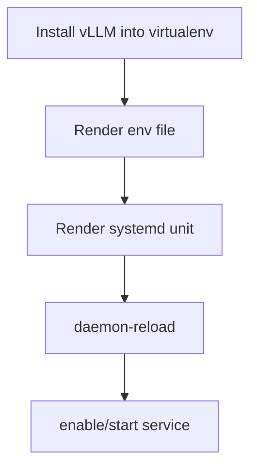

# Role: ct_runtime_vllm

## Purpose
Install/configure vLLM inside CT and manage it with systemd.

Supported CT distributions: Debian 12/13, Ubuntu 22.04/24.04 LTS, and RHEL/AlmaLinux/Rocky/Oracle Linux 9/10.

This role can consume shared values from `ct_runtime_launcher_common`, while runtime-specific variables (for example `ct_runtime_vllm_model`) continue to work as before.

## Usage
```yaml
- hosts: ct_targets
  become: true
  roles:
    - role: ktooi.pve_inference.ct_runtime_common
    - role: ktooi.pve_inference.ct_runtime_vllm
```

### Tuning example
```yaml
ct_runtime_vllm_model: "Qwen/Qwen3.5-27B"
ct_runtime_vllm_tensor_parallel_size: 4
ct_runtime_vllm_pipeline_parallel_size: 1
ct_runtime_vllm_gpu_memory_utilization: 0.88
ct_runtime_vllm_dtype: "auto"
ct_runtime_vllm_kv_cache_dtype: "auto"
ct_runtime_vllm_max_model_len: 262144
ct_runtime_vllm_max_num_seqs: 128
ct_runtime_vllm_max_num_batched_tokens: 8192
ct_runtime_vllm_tool_call_parser: "qwen3_coder"
ct_runtime_vllm_reasoning_parser: "qwen3"
ct_runtime_vllm_enable_auto_tool_choice: true
ct_runtime_vllm_served_model_name: "qwen3.5"
ct_runtime_vllm_nccl_p2p_disable: 0
ct_runtime_vllm_nccl_ib_disable: 0
ct_runtime_vllm_nccl_p2p_level: 5
ct_runtime_vllm_nccl_debug: "INFO"
ct_runtime_vllm_nccl_ignore_disabled_p2p: 1
ct_runtime_vllm_ld_library_path: "/usr/local/nvidia/lib64:/usr/local/nvidia/lib:/usr/lib/x86_64-linux-gnu"
```

## Flow


## Variables

| Variable | Description | Default | Allowed values |
|---|---|---|---|
| `ct_runtime_vllm_user` | Service user | `infer` | Existing Linux username |
| `ct_runtime_vllm_group` | Service group | `infer` | Existing Linux group |
| `ct_runtime_vllm_venv` | venv path containing `vllm` | `/opt/inference/venv` | Absolute path |
| `ct_runtime_vllm_workdir` | systemd WorkingDirectory | `/opt/inference` | Absolute path |
| `ct_runtime_vllm_env_file` | Environment file path | `/etc/default/vllm` | Absolute path |
| `ct_runtime_vllm_service_name` | systemd service unit name | `vllm.service` | Valid unit name |
| `ct_runtime_vllm_systemd_log_to_files` | Write service stdout/stderr to files via systemd `append:` | `true` | `true` / `false` |
| `ct_runtime_vllm_stdout_log` | vLLM stdout log file path (when file logging enabled) | `/var/log/inference/vllm.stdout.log` | Absolute path |
| `ct_runtime_vllm_stderr_log` | vLLM stderr log file path (when file logging enabled) | `/var/log/inference/vllm.stderr.log` | Absolute path |
| `ct_runtime_vllm_systemd_restart` | systemd restart policy for vLLM service | `on-failure` | `no`, `on-failure`, `always`, ... |
| `ct_runtime_vllm_systemd_restart_sec` | Delay before restart attempts | `3` | Integer/seconds string |
| `ct_runtime_vllm_install_cuda_userspace` | Install CUDA userspace libs inside CT | `true` | `true` / `false` |
| `ct_runtime_vllm_cuda_packages` | CUDA userspace package list | distro-dependent | Package list |
| `ct_runtime_vllm_fail_on_cuda_package_install` | Fail when CUDA package install fails | `false` | `true` / `false` |
| `ct_runtime_vllm_require_libcuda` | Require `libcuda.so.1` preflight check (when `ct_runtime_vllm_device=cuda`) | `true` | `true` / `false` |
| `ct_runtime_vllm_require_nvidia_smi` | Require `nvidia-smi -L` preflight check (when `ct_runtime_vllm_device=cuda`) | `true` | `true` / `false` |
| `ct_runtime_vllm_fail_on_nvidia_smi_probe` | Fail when `nvidia-smi` preflight fails | `false` | `true` / `false` |
| `ct_runtime_vllm_require_torch_cuda_available` | Require torch CUDA preflight probe (when `ct_runtime_vllm_device=cuda`) | `true` | `true` / `false` |
| `ct_runtime_vllm_torch_cuda_probe_mode` | Torch CUDA readiness mode | `strict` | `strict` (requires `is_available`+`device_count`), `count` (requires only `device_count`) |
| `ct_runtime_vllm_libcuda_candidate_paths` | Extra file paths checked for `libcuda.so.1` in CT | see defaults | List of absolute paths |
| `ct_runtime_vllm_require_nvidia_device_nodes` | Require `/dev/nvidia*` in CT (when `ct_runtime_vllm_device=cuda`) | `true` | `true` / `false` |
| `ct_runtime_vllm_device` | vLLM device selection | `cuda` | `cuda`, `cpu`, runtime-supported values |
| `ct_runtime_vllm_force_device_arg` | Force `--device` CLI arg even for CUDA (off by default for CLI compatibility) | `false` | `true` / `false` |
| `ct_runtime_vllm_logging_level` | vLLM logging verbosity | `INFO` | `DEBUG`, `INFO`, `WARNING`, ... |
| `ct_runtime_vllm_bind_host` | API bind host | `0.0.0.0` | IP/host string |
| `ct_runtime_vllm_port` | API port | `8000` | Integer `1..65535` |
| `ct_runtime_vllm_model` | Model identifier | `mistralai/Mistral-7B-Instruct-v0.3` | Valid model identifier |
| `ct_runtime_vllm_served_model_name` | Candidate served model name value | `""` | Empty, string, or list (first non-empty string is used) |
| `ct_runtime_vllm_pass_served_model_name` | Pass `--served-model-name` to vLLM CLI | `false` | `true` / `false` |
| `ct_runtime_vllm_tensor_parallel_size` | Tensor parallel size | `1` | Integer `>=1` |
| `ct_runtime_vllm_pipeline_parallel_size` | Pipeline parallel size | `1` | Integer `>=1` |
| `ct_runtime_vllm_gpu_memory_utilization` | GPU memory utilization ratio | `0.9` | Float `0.1..1.0` |
| `ct_runtime_vllm_dtype` | Weights/compute dtype | `auto` | `auto`, `float16`, `bfloat16`, etc. |
| `ct_runtime_vllm_kv_cache_dtype` | KV cache dtype | `auto` | `auto`, `fp8`, etc. |
| `ct_runtime_vllm_max_model_len` | Max model context length | `8192` | Integer `>=1` |
| `ct_runtime_vllm_max_num_seqs` | Max concurrent sequences | `32` | Integer `>=1` |
| `ct_runtime_vllm_max_num_batched_tokens` | Max batched tokens | `4096` | Integer `>=1` |
| `ct_runtime_vllm_tool_call_parser` | Tool call parser backend | `""` | Empty or parser name |
| `ct_runtime_vllm_reasoning_parser` | Reasoning parser backend | `""` | Empty or parser name |
| `ct_runtime_vllm_enable_auto_tool_choice` | Enable vLLM `--enable-auto-tool-choice` | `false` | `true` / `false` |
| `ct_runtime_vllm_nccl_p2p_disable` | NCCL P2P disable flag | `0` | `0` / `1` |
| `ct_runtime_vllm_nccl_ib_disable` | NCCL IB disable flag | `0` | `0` / `1` |
| `ct_runtime_vllm_nccl_p2p_level` | NCCL P2P level | `5` | Integer |
| `ct_runtime_vllm_nccl_debug` | NCCL debug level | `INFO` | `TRACE`, `INFO`, `WARN`, ... |
| `ct_runtime_vllm_nccl_ignore_disabled_p2p` | Ignore disabled P2P warning | `1` | `0` / `1` |
| `ct_runtime_vllm_omp_num_threads` | OMP thread count | `""` | Empty or integer string |
| `ct_runtime_vllm_ld_library_path` | Library search path | `/usr/local/nvidia/lib64:/usr/local/nvidia/lib:/usr/lib/x86_64-linux-gnu` | PATH-like string |
| `ct_runtime_vllm_hf_cache_dir` | Hugging Face cache dir | `""` | Empty or absolute path |
| `ct_runtime_vllm_hf_token` | Hugging Face Hub token exported as `HF_TOKEN` | `""` | Empty or token string (prefer Ansible Vault) |
| `ct_runtime_vllm_extra_args` | Extra CLI args | `""` | String |
| `ct_runtime_vllm_version` | Pin version (optional) | `""` | Empty or semantic version string |
| `ct_runtime_vllm_torch_package` | Optional explicit torch package to install in venv before CUDA probe | `""` | Empty or pip requirement string (e.g. `torch==2.6.0`) |
| `ct_runtime_vllm_torch_extra_index_url` | Optional extra index URL used with `ct_runtime_vllm_torch_package` | `""` | Empty or URL |


> CUDA preflight note: by default this role validates `/dev/nvidia*`, `libcuda.so.1`, `nvidia-smi -L`, and torch CUDA visibility. `nvidia-smi` failures are warnings by default (`ct_runtime_vllm_fail_on_nvidia_smi_probe: false`) while torch preflight remains enforced. Torch `strict` mode requires both `torch.cuda.is_available()==True` and `device_count > 0`. Use `ct_runtime_vllm_torch_cuda_probe_mode: count` only if you intentionally want a relaxed check.

> Driver/torch alignment note: when host driver is older than the default torch CUDA build bundled via `vllm`, set `ct_runtime_vllm_torch_package` and `ct_runtime_vllm_torch_extra_index_url` to install a compatible torch wheel explicitly before preflight (for example CUDA 12.4 wheels for NVIDIA 550-series hosts). If you pin torch, also pin a compatible `ct_runtime_vllm_version`; mismatched torch/vLLM binary ABI can cause `undefined symbol` import errors in `vllm._C`.

> Logging note: when `ct_runtime_vllm_systemd_log_to_files=true` (default), this role now mirrors stdout/stderr to both log files (`/var/log/inference/vllm.stdout.log`, `/var/log/inference/vllm.stderr.log`) and journald, so `journalctl -u vllm.service` remains usable.

> CLI compatibility note: older vLLM versions may reject `--device cuda`. This role omits `--device` for CUDA by default and only passes it for non-CUDA devices (or when `ct_runtime_vllm_force_device_arg=true`).

> Environment naming note: runtime command variables are exported with `INFER_VLLM_*` names (not `VLLM_*`) to avoid `Unknown vLLM environment variable` warnings emitted by newer vLLM versions.

> HF Hub authentication note: to avoid `Warning: You are sending unauthenticated requests to the HF Hub...`, set `ct_runtime_vllm_hf_token` (preferably via Ansible Vault) so the role writes `HF_TOKEN` into the runtime environment file.

> Restart-loop note: default policy is `on-failure` (not `always`) so normal exits do not loop forever. If you still see restarts, inspect `/var/log/inference/vllm.stderr.log` and kernel OOM logs (`dmesg -T | grep -i -E 'killed process|out of memory'`).

> Served-model-name note: if shared launcher vars accidentally provide a list (for example `['qwen3.5', None]`), this role normalizes it to the first non-empty string. Passing `--served-model-name` is disabled by default (`ct_runtime_vllm_pass_served_model_name=false`) because some vLLM versions reject/validate this path strictly.

> Extra-args note: `ct_runtime_vllm_extra_args` is appended only when non-empty, preventing empty trailing CLI arguments and accidental line-concatenation artifacts in systemd `ExecStart` parsing.

## 音声・画像・動画モデルのデプロイ

2026-11-03 に公式 main の資料を確認。対応モデル・API はインストールするリリースに依存します。
main に記載された新機能が過去の安定版で使えるとは限りません。

| 機能 | バックエンド | モデル例 / API |
|---|---|---|
| STT（文字起こし） | core | `openai/whisper-large-v3-turbo` / `/v1/audio/transcriptions` |
| 話者分離付き文字起こし | core | `OpenMOSS-Team/MOSS-Transcribe-Diarize` / 同 API の `diarized_json` |
| 画像生成 | omni（vLLM-Omni が必要） | `Qwen/Qwen-Image` / `/v1/images/generations` |
| 動画生成 | omni（vLLM-Omni が必要） | `Wan-AI/Wan2.2-T2V-A14B-Diffusers` / `/v1/videos` |

Whisper 自体は話者分離モデルではありません。`diarized_json` は対応モデル専用です。
ここでの話者分離は話者ラベル・時間区間付き文字起こしであり、話者ごとの音声ファイルへの音源分離ではありません。
通常の vLLM の画像・動画「入力」対応と、Omni の画像・動画「生成」対応は異なります。

### 共通の実行方法

GPU パススルー済み CT と、`ct_targets` を含む inventory を用意し、下記のいずれかを
`group_vars/ct_targets.yml` に設定します。1 サービスで 1 モデルを配置します。
複数機能を同時提供する場合は CT ごとにモデルを分け、GPU メモリの割り当てを設計してください。

```bash
ansible-playbook -i inventory.ini playbooks/runtime_vllm.yml
```

### STT

```yaml
ct_runtime_vllm_backend: core
ct_runtime_vllm_audio: true
ct_runtime_vllm_model: openai/whisper-large-v3-turbo
ct_runtime_vllm_max_model_len: 448
ct_runtime_vllm_max_num_batched_tokens: 4096
```

```bash
curl --fail http://CT_HOST:8000/v1/audio/transcriptions \
  -F model=openai/whisper-large-v3-turbo -F file=@speech.wav \
  -F language=ja -F response_format=json
```

### 話者分離付き STT

```yaml
ct_runtime_vllm_backend: core
ct_runtime_vllm_audio: true
ct_runtime_vllm_model: OpenMOSS-Team/MOSS-Transcribe-Diarize
ct_runtime_vllm_max_model_len: 8192
```

```bash
curl --fail http://CT_HOST:8000/v1/audio/transcriptions \
  -F model=OpenMOSS-Team/MOSS-Transcribe-Diarize -F file=@meeting.wav \
  -F response_format=diarized_json
```

応答の `segments` に `speaker`、`start`、`end`、`text` が含まれます。
採用リリースの対応モデル一覧に MOSS があることを確認してください。古い vLLM では更新が必要です。

### 画像生成 / 動画生成

```yaml
ct_runtime_vllm_backend: omni
ct_runtime_vllm_model: Qwen/Qwen-Image
# 動画生成では上記を次に置き換える:
# ct_runtime_vllm_model: Wan-AI/Wan2.2-T2V-A14B-Diffusers
ct_runtime_vllm_version: '0.32.0'
ct_runtime_vllm_omni_version: '0.32.0'
```

0.32.0 の組み合わせは確認時の Omni 公式インストール手順に基づきます。
公式のテスト環境は Python 3.12 / PyTorch 2.13 / CUDA 13.0 です。
互換性のある NVIDIA ドライバと十分な VRAM が必要です。CT の OS 対応だけでは
wheel・Python・CUDA の互換性を保証しません。新しい専用 venv を推奨します。
`ct_runtime_common` とこの Role の venv 設定を同じパスに合わせてください。
Omni では通常の LLM 用メモリ・KV cache・tool parser・並列化引数を自動追加しません。
モデル固有の並列化や offload は公式手順に従い `ct_runtime_vllm_extra_args` で指定します。

```bash
curl --fail http://CT_HOST:8000/v1/images/generations \
  -H 'Content-Type: application/json' \
  -d '{"model":"Qwen/Qwen-Image","prompt":"A cat in a garden","size":"1024x1024"}'

curl --fail http://CT_HOST:8000/v1/videos \
  -F model=Wan-AI/Wan2.2-T2V-A14B-Diffusers \
  -F prompt='A cat walking through a garden'
```

動画 API は非同期です。返された `id` を使い `GET /v1/videos/{id}` で完了を確認し、
`GET /v1/videos/{id}/content` から保存します。解像度・フレーム数等はモデル固有です。

### 最新版への更新とバージョン管理

| 変数 | 既定値 | 用途 |
|---|---|---|
| `ct_runtime_vllm_backend` | `core` | `core` または `omni` |
| `ct_runtime_vllm_audio` | `false` | `vllm[audio]` の音声依存を追加 |
| `ct_runtime_vllm_pip_state` | `present` | `latest` で Role 再実行時に更新 |
| `ct_runtime_vllm_version` | 空文字 | vLLM のバージョン固定。空なら固定しない |
| `ct_runtime_vllm_omni_version` | 空文字 | Omni のバージョン固定 |
| `ct_runtime_vllm_additional_packages` | `[]` | モデル固有の追加 pip 要件 |

最新版を追従するにはバージョン固定を空にし `ct_runtime_vllm_pip_state: latest` を指定します。
vLLM と Omni は同一 pip 呼び出しで依存解決し、更新時にサービス再起動を通知します。
Omni の互換性制約によって選ばれる vLLM は、単独の vLLM 最新版とは異なる場合があります。
本番環境では公式互換表に従って両方を固定し、更新前に専用 CT で実際の音声・生成リクエストを検証してください。
任意の将来バージョンの動作を保証するものではありません。
追加の CLI オプションは `ct_runtime_vllm_extra_args` で指定できます（管理者が信頼する値のみ）。
モデル取得用のネットワーク接続と、必要に応じて Vault 管理の `ct_runtime_vllm_hf_token` を用意します。
API は内部ネットワークや認証付きプロキシの背後で公開してください。

### 公式資料・検証範囲

- [vLLM 対応モデル](https://github.com/vllm-project/vllm/blob/9226d6e59cd12ddd9a80b7d5ed37b16e186d29c6/docs/models/supported_models.md)
- [STT / diarized_json](https://github.com/vllm-project/vllm/blob/9226d6e59cd12ddd9a80b7d5ed37b16e186d29c6/docs/serving/online_serving/speech_to_text.md)
- [Omni インストール](https://github.com/vllm-project/vllm-omni/blob/c4b31f0c56ab1f4e33f286c5d1c72268b8cf35a5/docs/getting_started/installation/gpu/cuda.inc.md)
- [Omni 動画 API](https://github.com/vllm-project/vllm-omni/blob/c4b31f0c56ab1f4e33f286c5d1c72268b8cf35a5/docs/user_guide/examples/online_serving/text_to_video.md)

この変更のローカル検証は設定・テンプレート・Ansible 構文までです。
GPU でのモデルロード、認識精度、画像・動画生成の実機検証は未実施です。
